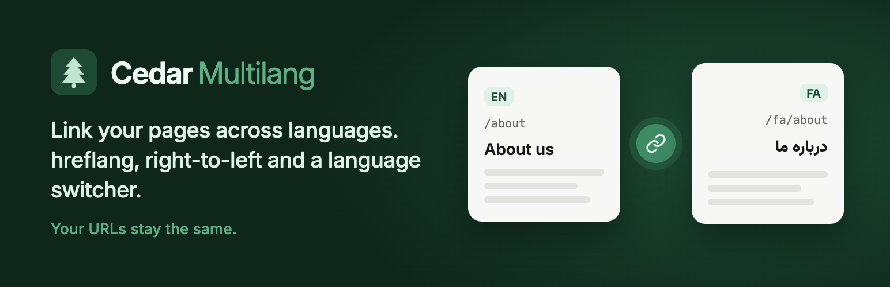
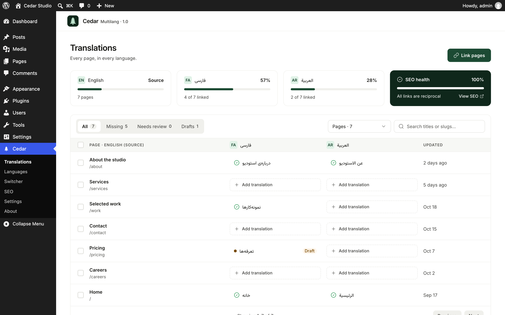
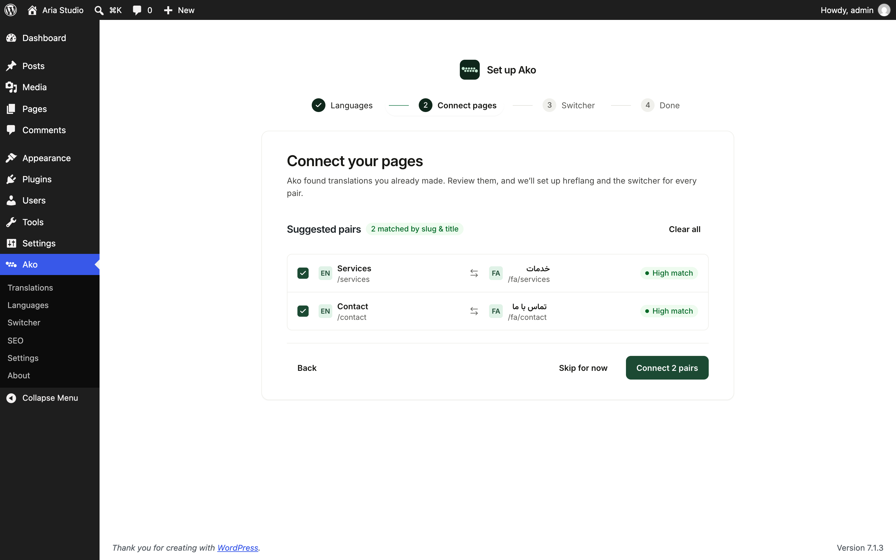
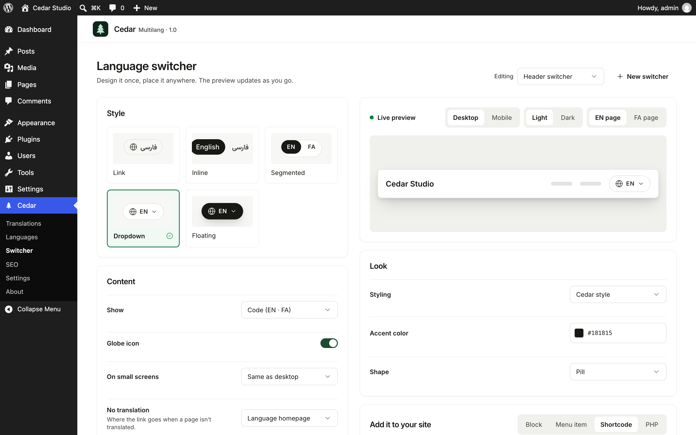
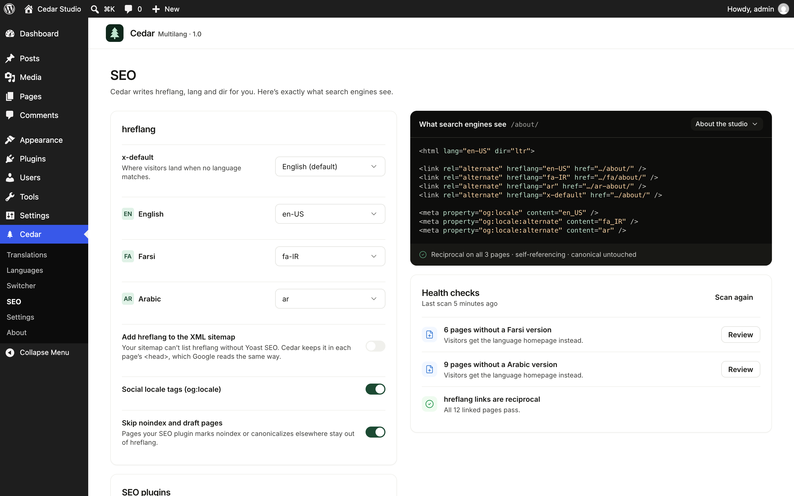

# Ako Multilang



A lightweight WordPress plugin that links your pages across languages. It adds hreflang, right-to-left support, and a language switcher, and your URLs stay the same.

Ako is made for bilingual sites with a right-to-left language, like Farsi, Arabic, or Hebrew next to English. It doesn't translate content. It connects the pages you've already written, so it fits right into a site you've already built.

## What it does

- **Links pages across languages.** Any post, page, or custom post type, from the editor, the Translations screen, or the setup.
- **Sets up in a few minutes.** Setup finds the languages your site already uses, suggests page pairs from your URLs and titles, and adds the switcher to your header menu.
- **Handles SEO for you.** hreflang with x-default, the right `lang` and `dir`, and `og:locale`. Works alongside Yoast SEO, Rank Math, and All in One SEO.
- **Gets right-to-left right.** Each page loads in its own language, so your theme's RTL styles load. The block editor switches to right-to-left while you write.
- **Ships a real language switcher.** Five looks with a live preview. Add it as a block, a menu item, a shortcode, or a floating button.
- **Imports from WPML and Polylang.** Ako only reads their data, so you can switch back anytime.
- **Stays private.** No external requests, no tracking, no data collection.

## Screenshots

| Translations | Setup |
| --- | --- |
|  |  |
| **Switcher** | **SEO** |
|  |  |

## Install

Download `ako-multilang.zip` from the [latest release](https://github.com/Sepehrnasihatgar/ako-multilang/releases/latest), then go to **Plugins → Add New → Upload Plugin** in WordPress.

Requires WordPress 6.6 or newer and PHP 7.4 or newer.

## Tested with

Astra, Hello Elementor, GeneratePress, Kadence, OceanWP, Neve, Blocksy, Twenty Twenty-Five, Twenty Twenty-Four, Twenty Twenty-One, and Elementor. Every theme was checked on desktop and mobile, on English and Farsi pages, with each switcher look.

## Development

```bash
npm install
composer install
npm run build
```

- `npm run start` rebuilds the admin as you edit.
- `composer lint` runs PHPCS with the WordPress coding standards. It should pass with no errors or warnings.
- `npm run lint:js` and `npm run lint:css` check the JavaScript and CSS.
- `npm run plugin-zip` builds the release zip.
- `npm run playground` starts a local WordPress with the plugin mounted.

How the code is organized is in [docs/architecture.md](docs/architecture.md). The product brief is in [docs/brief.md](docs/brief.md).

## License

Copyright 2026 Sepehr Nasihatgar. Released under GPLv2 or later. See [LICENSE](LICENSE).

The GPL covers the code. It doesn't grant rights to the Ako Multilang name or logo.

Ako Multilang was called Cedar Multilang before its first public release.

The admin uses the Inter and Vazirmatn fonts (SIL Open Font License 1.1) and Lucide icons (ISC License). Their licenses ship with the plugin.

Built by [Sepehr Nasihatgar](https://github.com/Sepehrnasihatgar).
